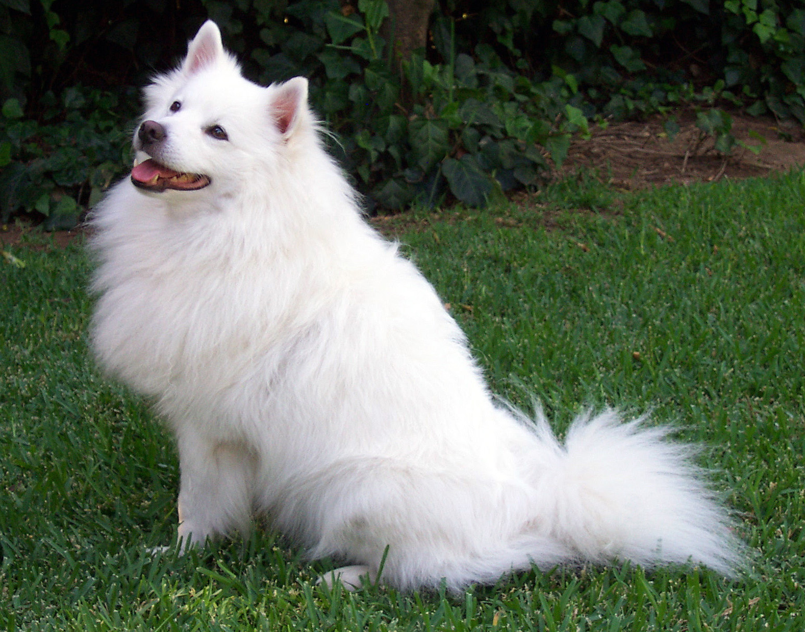
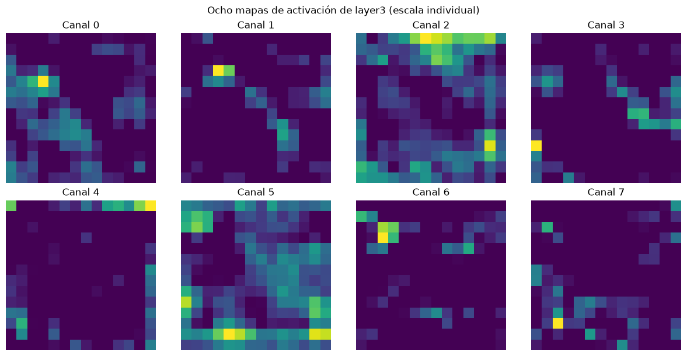
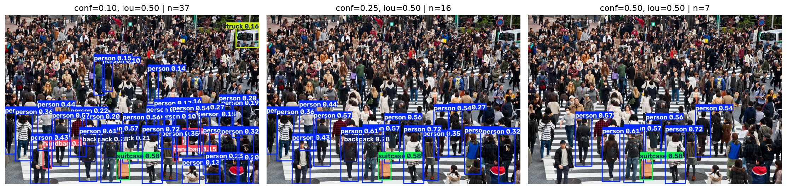
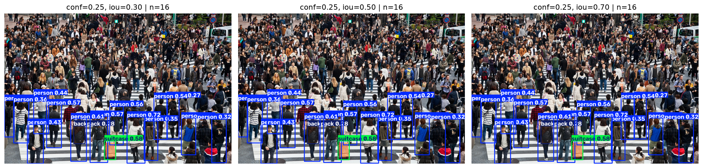
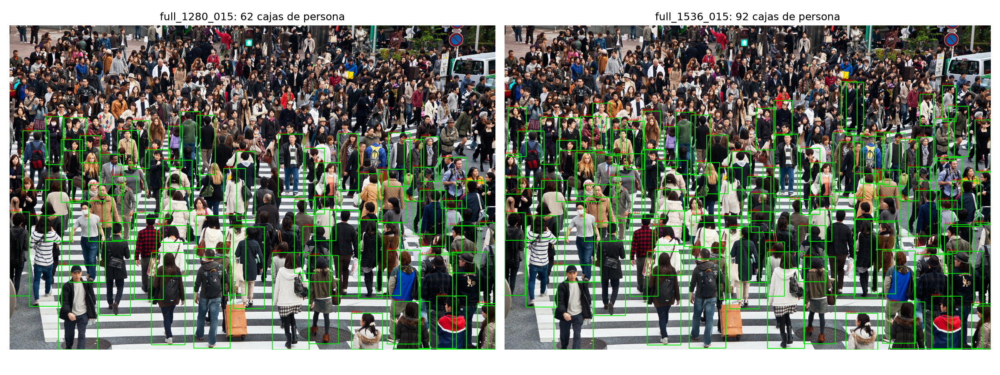
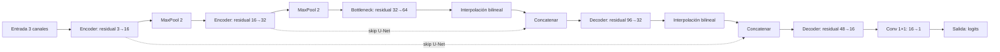

# Examen de Visión por Computador

Tres ejercicios resueltos: clasificación con encoders, detección con YOLO y una arquitectura Residual U-Net.

| Ejercicio | Descripción | Notebook |
|---|---|---|
| 1. Encoders | ResNet18 + feature maps | [Abrir](ejercicios/01_encoders/encoders.ipynb) |
| 2. YOLO | Detección y comparación de umbrales | [Abrir](ejercicios/02_yolo/yolo.ipynb) |
| 3. U-Net | Arquitectura residual personalizada | [Abrir](ejercicios/03_unet/unet.ipynb) |

## 1. Encoders — ResNet18

Imagen original y ocho mapas de activación de `layer3` ([notebook](ejercicios/01_encoders/encoders.ipynb)):




Predicción: **Samoyed**, 88,46 %; entrada `(1, 3, 224, 224)`, `layer3` `(1, 256, 14, 14)` y logits `(1, 1000)`.

## 2. YOLO — Detección y umbrales

Imagen de entrada y detecciones para tres umbrales de confianza ([notebook](ejercicios/02_yolo/yolo.ipynb)):





| Comparación | conf | IoU NMS | Detecciones |
|---|---:|---:|---:|
| Confianza | 0.10 | 0.50 | 37 |
| Confianza — baseline | 0.25 | 0.50 | 16 |
| Confianza | 0.50 | 0.50 | 7 |
| IoU | 0.25 | 0.30 | 16 |
| IoU — baseline | 0.25 | 0.50 | 16 |
| IoU | 0.25 | 0.70 | 16 |

Se muestran seis paneles y cinco configuraciones distintas: el baseline se repite. `conf` descarta predicciones por debajo del umbral de confianza; `iou` controla el solapamiento usado por NMS para suprimir cajas redundantes. Sin anotaciones de referencia, el número de detecciones no mide precisión. La imagen de entrada procede de Shutterstock; comprobar su licencia antes de redistribuirla.

### Experimento complementario



| Método | Resolución/tile | conf | Cajas de persona | CPU (ms) |
|---|---:|---:|---:|---:|
| Imagen completa | 1280 | 0.15 | 62 | 170 |
| Imagen completa | 1280 | 0.10 | 84 | 164 |
| Imagen completa | 1280 | 0.12 | 75 | 219 |
| Imagen completa | 1536 | 0.15 | 92 | 275 |
| Imagen completa | 1536 | 0.10 | 107 | 254 |
| Slicing refinado | 768 | 0.10 | 143 | 561 |
| Slicing refinado | 768 | 0.12 | 128 | 672 |
| Slicing refinado | 768 | 0.15 | 105 | 679 |

Tiempos: medianas de tres ejecuciones en CPU, variables según la carga. Se recomienda provisionalmente YOLO11n con imagen completa, `imgsz=1536`, `conf=0.15`, `iou=0.50`, `classes=[0]`: 92 cajas frente a 62 en la referencia optimizada anterior y 14 personas en el baseline de 640. La mayor resolución conserva más detalle sin los cortes de slicing; la selección es visual, no una mejora de precisión demostrada. [Resultados y protocolo](ejercicios/02_yolo/README.md#análisis-complementario) · [CSV](ejercicios/02_yolo/outputs/refinamiento.csv).

## 3. Residual U-Net

Arquitectura de [model.py](ejercicios/03_unet/model.py) con canales por defecto ([notebook](ejercicios/03_unet/unet.ipynb)):



Cada bloque residual suma internamente una ruta identidad o proyección 1×1 a dos convoluciones 3×3; las líneas discontinuas son las concatenaciones U-Net entre etapas. **125 041 parámetros**; formas verificadas: `(1, 3, 128, 128)` → `(1, 1, 128, 128)` y `(1, 3, 129, 131)` → `(1, 1, 129, 131)`. La red no está entrenada: sus logits no son una segmentación validada.

## Reproducción rápida

Desde la raíz del proyecto en Windows, con Python y acceso a internet para instalar dependencias:

```powershell
python -m venv .venv
.\.venv\Scripts\python -m pip install -r requirements.txt
.\.venv\Scripts\python -m ipykernel install --user --name examen-cv --display-name "Python (examen-cv)"
.\.venv\Scripts\python -m jupyter notebook
```

Abre los tres notebooks desde la tabla en orden 1 → 2 → 3; en cada uno selecciona **Python (examen-cv)** y ejecuta todas las celdas desde un kernel reiniciado. CPU es suficiente; CUDA es opcional y requiere una instalación de PyTorch compatible con la GPU. Las dependencias están fijadas a versiones observadas en los entornos probados; instalar un entorno nuevo requiere internet. La imagen y los pesos usados están en sus carpetas `data/` y `models/`; si faltan, el ejercicio 1 necesita internet para descargarlos y el 2 requiere recuperar sus archivos locales. Ejecuta Jupyter desde la raíz o la carpeta de cada ejercicio.
