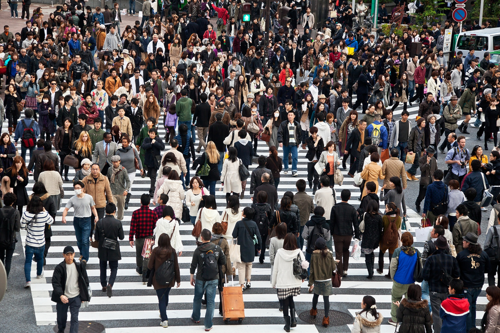

# Ejercicio 2: YOLO11n

Detección sin entrenamiento en una escena concurrida. Imagen: Shutterstock, recurso 86973980; verificar la licencia antes de redistribuirla.



## Experimento obligatorio: filtros

`conf` es el umbral mínimo de confianza; `iou` controla la supresión de cajas solapadas mediante NMS. Las seis comparaciones visuales incluyen el baseline dos veces, por lo que representan cinco configuraciones únicas.

| Comparación | conf | IoU NMS | Detecciones de todas las clases |
|---|---:|---:|---:|
| Confianza | 0.10 | 0.50 | 37 |
| Confianza — baseline | 0.25 | 0.50 | 16 |
| Confianza | 0.50 | 0.50 | 7 |
| IoU | 0.25 | 0.30 | 16 |
| IoU — baseline | 0.25 | 0.50 | 16 |
| IoU | 0.25 | 0.70 | 16 |

[Comparación de confianza](outputs/comparacion_conf.png) · [comparación de IoU](outputs/comparacion_iou.png) · [CSV](outputs/detecciones.csv).

## Análisis complementario

| Método | Resolución/tile | conf | Cajas de persona | CPU (ms) |
|---|---:|---:|---:|---:|
| Imagen completa | 1280 | 0.15 | 62 | 170 |
| Imagen completa | 1280 | 0.10 | 84 | 164 |
| Imagen completa | 1280 | 0.12 | 75 | 219 |
| Imagen completa | 1536 | 0.15 | 92 | 275 |
| Imagen completa | 1536 | 0.10 | 107 | 254 |
| Slicing refinado | 768 | 0.10 | 143 | 561 |
| Slicing refinado | 768 | 0.12 | 128 | 672 |
| Slicing refinado | 768 | 0.15 | 105 | 679 |

Tiempos: medianas de tres ejecuciones en CPU; varían con la carga. **Selección provisional:** imagen completa con YOLO11n, `imgsz=1536`, `conf=0.15`, `iou=0.50`, `classes=[0]`: 92 cajas, frente a 62 en la referencia 1280/0.15 y 14 personas en el baseline 640/0.25. La resolución mayor conserva más detalle de personas pequeñas y evita los cortes de slicing; la elección se basa en inspección visual y no demuestra una mejora de precisión.

El slicing refinado usa tiles de 768 píxeles con 25 % de solapamiento, filtra centros cercanos a cortes internos, rechaza cajas truncadas y aplica NMS global. Llegó a 143 cajas, pero puede generar duplicados o fragmentos y descartar detecciones válidas. Las guardas de tamaño/aspecto no descartaron ninguna caja; no se les atribuye una mejora.

[Selección final](outputs/refinamiento_seleccion_final.png) · [comparación de refinamiento](outputs/refinamiento_comparacion.png) · [resultados](outputs/refinamiento.csv) · [protocolo](outputs/refinamiento_protocolo.json) · [resoluciones previas](outputs/resoluciones.png). Sin anotaciones verificadas, el número de cajas no equivale al número real de personas.

## Ejecución

Prepara el entorno común siguiendo el README principal. Desde la raíz del proyecto en Windows:
```powershell
.\.venv\Scripts\python -m jupyter notebook ejercicios/02_yolo/yolo.ipynb
```
Selecciona **Python (examen-cv)** y ejecuta todas las celdas. Se necesitan [complementario.py](complementario.py), [refinamiento.py](refinamiento.py), `data/crowd.jpg` y [models/yolo11n.pt](models/yolo11n.pt); el modelo y la imagen se leen localmente.
