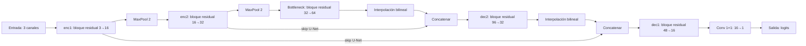

# Ejercicio 3: Residual U-Net

Red ligera de segmentación binaria sin entrenar: devuelve logits, no una máscara fiable.

## Arquitectura



Cada bloque residual suma una ruta identidad o proyección 1×1 a su rama de dos convoluciones 3×3. Las conexiones U-Net concatenan encoder y decoder. Los canales mostrados corresponden a los valores por defecto de [model.py](model.py).

## Ejecución

Prepara el entorno común siguiendo el README principal. Desde la raíz del proyecto en Windows:
```powershell
.\.venv\Scripts\python -m jupyter notebook 03_unet/unet.ipynb
```
Selecciona el kernel **Python (examen-cv)** y ejecuta todas las celdas. El notebook comprueba dimensiones y gradientes de dos parámetros seleccionados con tensores sintéticos; no descarga datos ni pesos. Mantén [model.py](model.py) junto a [unet.ipynb](unet.ipynb).
